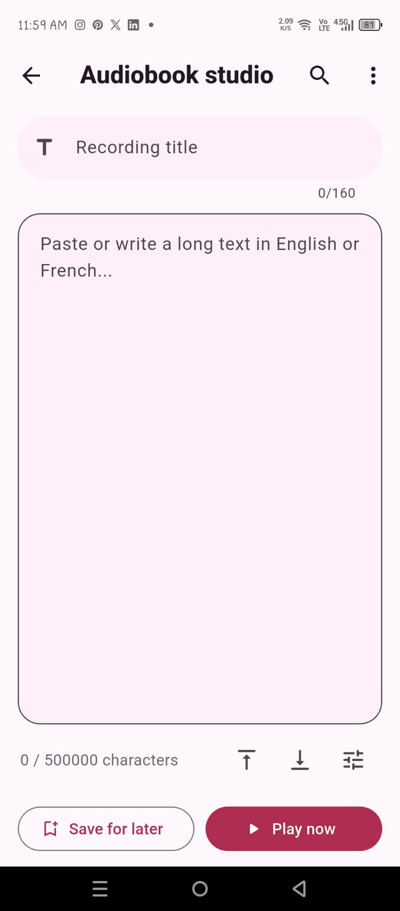
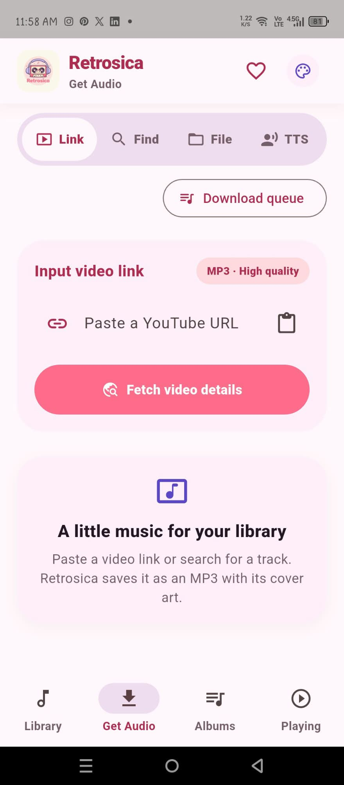
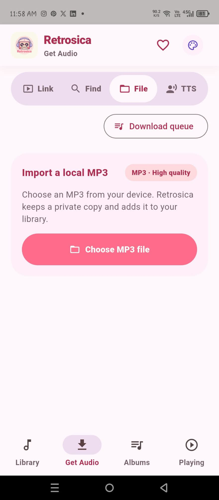
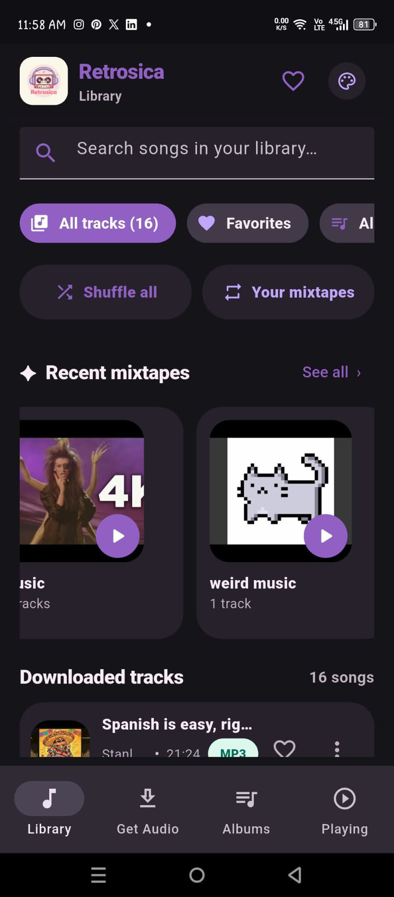
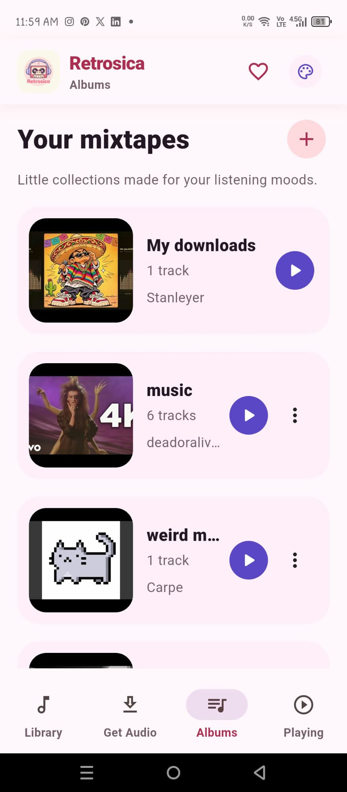
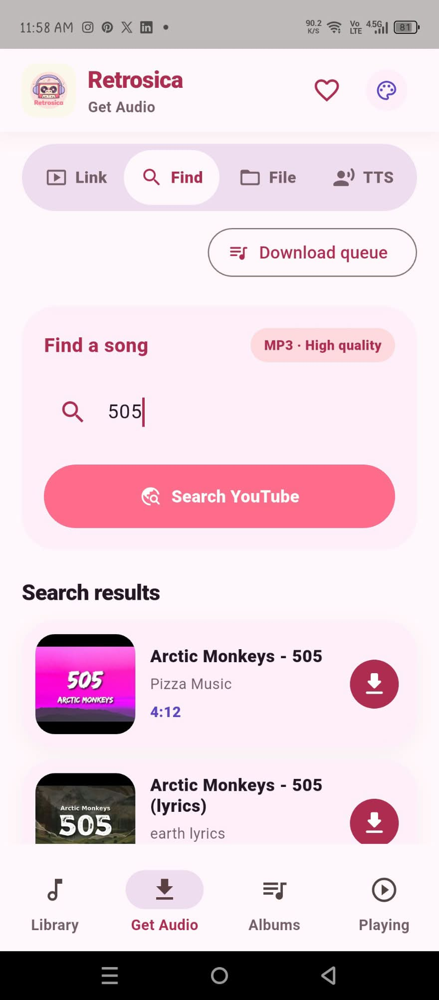
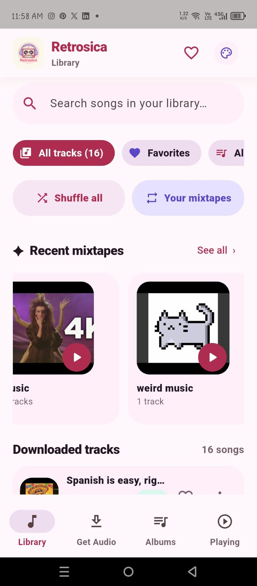

# Retrosica

Retrosica is a cozy, offline-first music library for saving permitted YouTube audio as MP3, organizing tracks into mixtapes, and playing local music with system media controls.

## Screenshots

<p float="left">
  
  
  
  
</p>

<p float="left">
  
  
  
</p>

## Features

- Browse and search a persistent on-device music library.
- Search YouTube or paste a video URL and preview metadata and cover art.
- Download MP3 files through the Retrosica API.
- Import local MP3 files and organize tracks into mixtapes.
- Edit display titles and MP3 filenames.
- Use favorites, a mini player, and Android/iOS system media controls.
- Stream and save English or French Kokoro text-to-speech audio.

## Repository layout

- [`retrosica_v3`](./retrosica_v3) - Flutter Android and iOS application.
- [`api`](./api) - ASP.NET Core download and text-to-speech API.
- [`stitch_melodybox_cute_offline_music`](./stitch_melodybox_cute_offline_music) - Interface design exports.
- [`stitch_melodybox_cute_offline_music_logo`](./stitch_melodybox_cute_offline_music_logo) - Logo design source.

## Run the app

```powershell
cd retrosica_v3
flutter pub get
flutter run
```

The app uses `https://ahmed.tail867339.ts.net` by default. Override the API address with:

```powershell
flutter run --dart-define=RETROSICA_API_URL=https://YOUR_FUNNEL_HOST
```

For local network development, use `http://YOUR_COMPUTER_LAN_IP:8081`.

## Run the API

```powershell
cd api
Copy-Item .env.example .env
docker compose up -d --build
```

Set a private `POSTGRES_PASSWORD` in `api/.env`. The API health endpoint is available at `http://localhost:8081/healthz`.

See [`api/README.md`](./api/README.md) for endpoints, storage, Docker configuration, and text-to-speech details.
